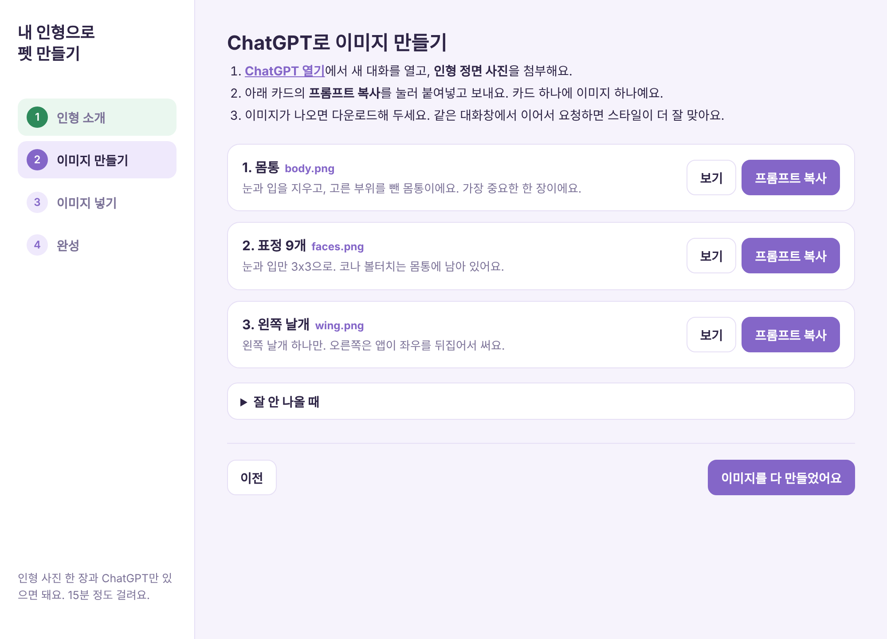
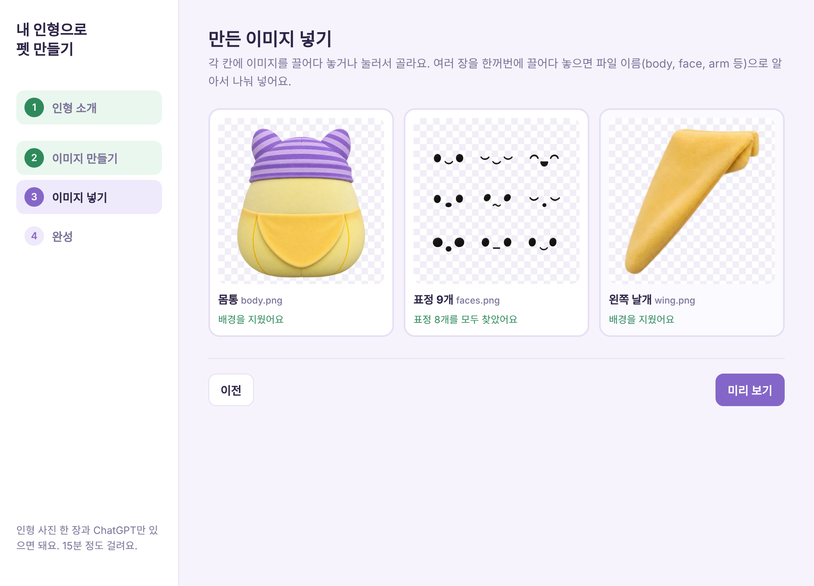
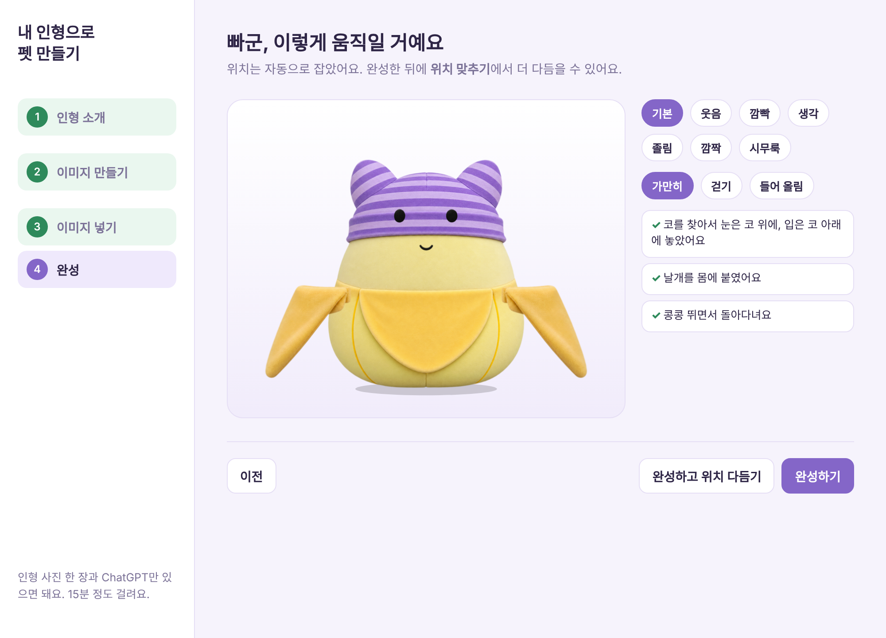
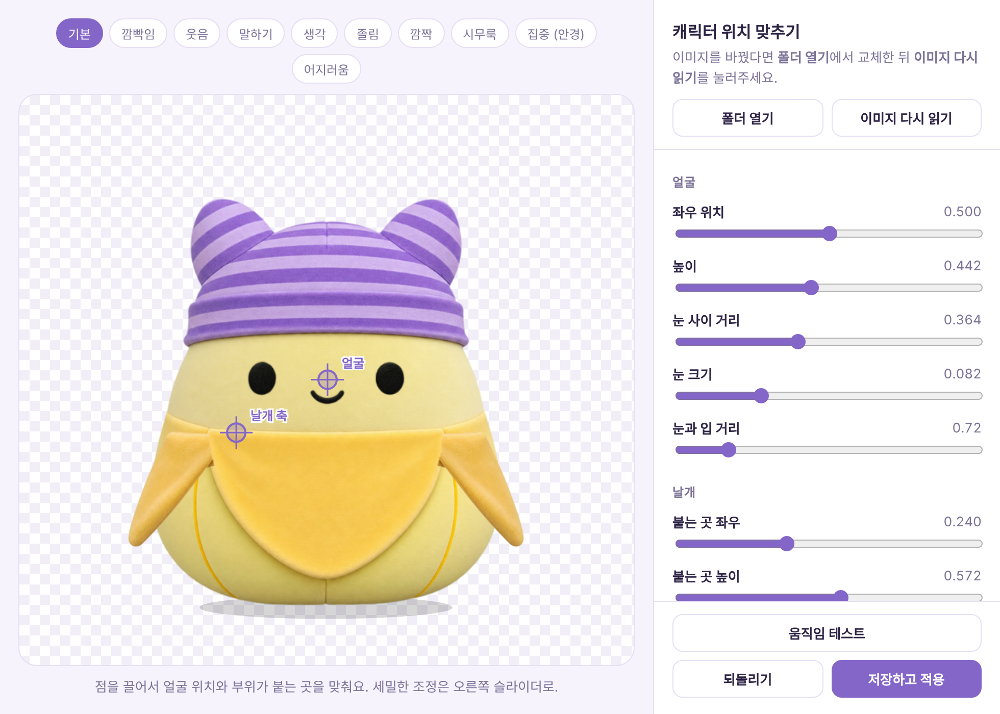

# 내 애착인형으로 데스크탑 펫 만들기

내 인형이 맥 화면 아래를 돌아다니고, 쓰다듬으면 좋아하고, 같이 집중해 주는 펫으로 만들어 봐요.
**준비물은 인형 정면 사진 한 장과 ChatGPT**예요. 처음 해도 15~20분이면 끝나요.

---

## 0. 준비하기

**앱 설치**
1. [Releases](https://github.com/lilykwon/bba-releases/releases/latest)에서 `.dmg` 파일을 내려받아 열어요
2. **Bba**를 응용 프로그램 폴더로 끌어다 놓고 실행해요
3. 화면 아래에 기본 캐릭터 빠군이 톡 떨어지면 성공이에요

**인형 사진 찍기**
- 인형을 **정면**에서, 얼굴과 팔다리가 다 보이게 찍어요
- 밝은 곳에서, 배경은 단순할수록 좋아요 (흰 벽이나 이불 위)
- 인형만 화면에 꽉 차게, 그림자는 적게

**ChatGPT**
- 이미지를 만들 수 있는 계정이면 돼요. 무료 계정은 하루에 만들 수 있는 이미지 수가 적어서, 한 번에 다 못 만들면 다음 날 이어서 해도 돼요

---

## 1. 인형 소개하기

펫을 **우클릭 > 캐릭터 > 내 인형으로 새로 만들기...** 를 눌러요.

- **이름:** 펫이 이 이름으로 자기를 소개해요
- **따로 움직였으면 하는 부위:** 인형에 있는 것만 골라요
  - 곰 인형이라면 귀, 팔, 다리
  - 토끼라면 귀, 다리, 꼬리
  - 구름이나 공 모양처럼 팔다리가 없으면 아무것도 고르지 않아도 돼요
  - 몸에 딱 붙어 있어서 굳이 안 움직여도 되는 부위는 고르지 마세요. 몸통 그림에 그대로 남아요
- **움직이는 방식:** 보통은 **자동**이면 돼요 (다리가 있으면 걷고, 없으면 콩콩). 떠다니는 인형은 **둥둥**

---

## 2. ChatGPT로 이미지 만들기

1. **ChatGPT 열기**를 누르고 새 대화를 열어요
2. **인형 사진을 첨부**해요
3. 첫 번째 카드(몸통)의 **프롬프트 복사**를 누르고, ChatGPT에 붙여넣어 보내요
4. 이미지가 나오면 **다운로드**해요
5. 같은 대화창에서 다음 카드의 프롬프트를 보내요 (사진은 다시 첨부 안 해도 돼요)
6. 카드 수만큼 반복해요

**잘 만드는 요령**
- **몸통이 제일 중요해요.** 원본과 다르면 같은 프롬프트로 다시 만들어서 가장 비슷한 걸 고르세요
- 다운로드한 파일 이름을 `body`, `face`, `arm`처럼 바꿔 두면 다음 단계에서 한 번에 끌어다 놓을 수 있어요 (안 바꿔도 돼요)
- 흰 인형이면 배경이 연두색으로 나와요. 정상이에요. 앱이 지워요

---

## 3. 이미지 넣기

- 각 칸에 맞는 이미지를 끌어다 놓거나, 칸을 눌러서 골라요
- 넣자마자 **배경을 지운 모습**이 보여요. 칸 아래 초록 글씨가 나오면 잘 된 거예요
- **표정 칸**은 "표정 8개를 모두 찾았어요"가 나와야 좋아요. 개수가 적으면 빈 표정은 비슷한 표정으로 대신해요
- 주황 글씨("배경이 안 지워졌어요")가 나오면 ChatGPT에 "배경을 한 가지 색으로 다시 만들어줘"라고 해서 다시 받아요

---

## 4. 완성

- 앱이 눈 위치, 코, 팔다리 붙는 곳을 **자동으로** 잡아요
- 오른쪽 버튼으로 표정(웃음, 졸림 등)과 움직임(걷기, 들어 올림)을 미리 볼 수 있어요
- **완성하기**를 누르면 화면의 펫이 바뀌고, 새 펫이 위에서 톡 떨어지며 인사해요
- 위치가 조금 어색하면 **완성하고 위치 다듬기**를 눌러요

---

## 5. 위치 다듬기 (필요할 때만)

**우클릭 > 캐릭터 > 위치 맞추기...**

- **얼굴 점:** 두 눈의 한가운데에 맞춰요
- **부위 축 점(귀 축, 팔 축, 다리 축):** 부위가 몸에 붙는 곳이에요. 움직일 때 이 점을 중심으로 돌아요
- 오른쪽 슬라이더로 눈 크기, 눈 사이 거리, 부위 크기, 움직임 세기를 조절해요
- **움직임 테스트**로 걷는 모습을 확인하고, 위쪽 칩으로 표정을 바꿔 보며 확인해요
- **저장하고 적용**을 누르면 바로 바뀌어요

자주 고치는 것:

| 이럴 때 | 이렇게 |
|---|---|
| 눈이 너무 커요 / 작아요 | **눈 크기** |
| 입이 코에 겹쳐요 | **눈과 입 거리**를 키워요 |
| 팔이 몸에서 떨어져 보여요 | **팔 축** 점을 몸 안쪽으로 끌어요 |
| 다리가 너무 길어 보여요 | 다리 **크기**를 줄이거나 **다리 축**을 아래로 |
| 귀가 머리 앞에 보여요 | 귀 **앞뒤**를 **몸 뒤**로 |
| 펫이 너무 커요 | 맨 아래 **화면에 보이는 크기** |

---

## 6. 자랑하고 나누기

- **우클릭 > 캐릭터 > 캐릭터 내보내기...** 로 내 펫을 `.petchar` 파일 하나로 저장해요
- 친구는 **캐릭터 가져오기...** 로 열면 똑같은 펫을 쓸 수 있어요
- 다른 캐릭터로 바꿔도 예전 캐릭터는 자동 백업돼요. **백업에서 되돌리기**로 언제든 돌아와요

---

## 펫이랑 놀기

| 이렇게 하면 | 펫은 |
|---|---|
| 머리 위에서 마우스를 좌우로 (쓰담쓰담) | 하트가 뾰로롱 |
| 높이서 떨구기 | 삐쳐요. 쓰다듬어 주면 풀려요 |
| 들고 마구 흔들기 | 눈이 빙글빙글 |
| 빠르게 세 번 콕콕 | 간지러워해요 |
| "30분 집중할게" | 안경 쓰고 옆에서 카운트다운 |
| "3시에 미팅 알려줘" | 그 시간에 알려줘요 |

대화까지 하고 싶다면 [README의 Claude 연결하기 / ChatGPT 연결하기](README.md#claude-연결하기)를 보세요. 연결 안 해도 위 기능은 다 돼요.

---

## 자주 막히는 곳

- **배경이 안 지워져요:** 배경이 여러 색이거나 그림자가 있으면 그래요. 한 가지 색 배경으로 다시 받아요
- **흰 인형 일부가 같이 지워져요:** 배경을 연두색처럼 인형과 다른 색으로 받아요
- **표정을 못 찾아요:** 표정 시트는 흰 배경에 검은 눈, 입만 있어야 해요. 머리 윤곽이나 볼터치가 같이 그려졌다면 다시 받아요
- **팔다리가 반대로 붙어요:** 부위는 화면 기준 **왼쪽** 것을 받아야 해요. 프롬프트대로 다시 받거나, 위치 맞추기에서 축 점을 옮겨요
