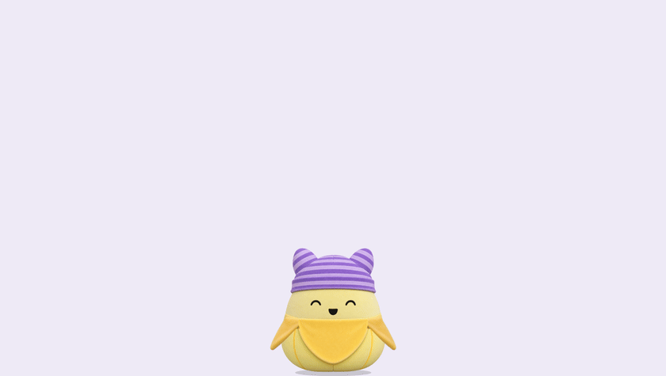
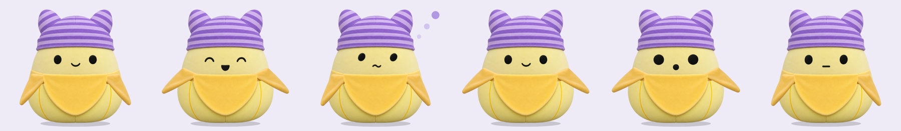
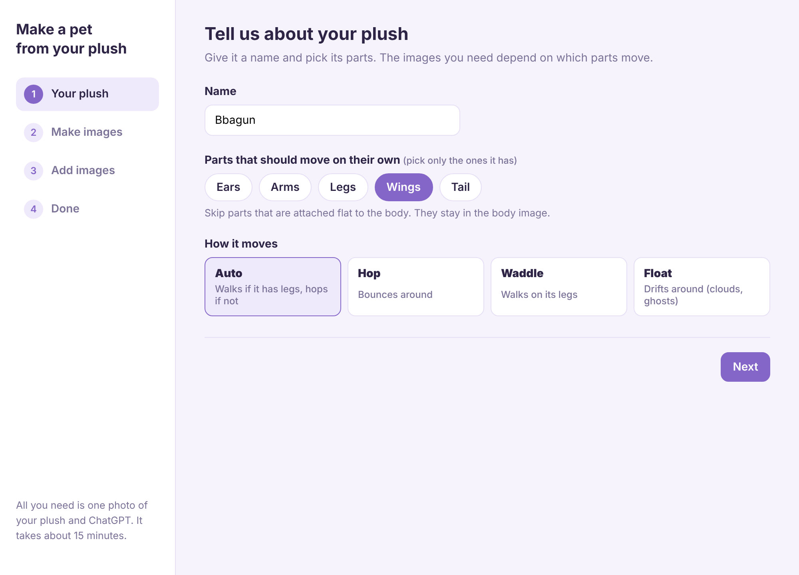
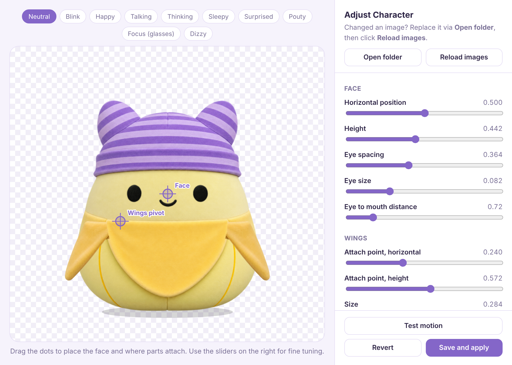
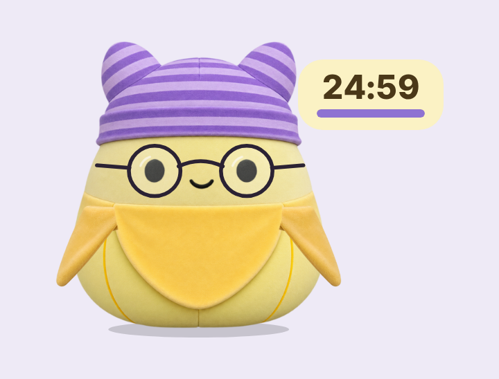
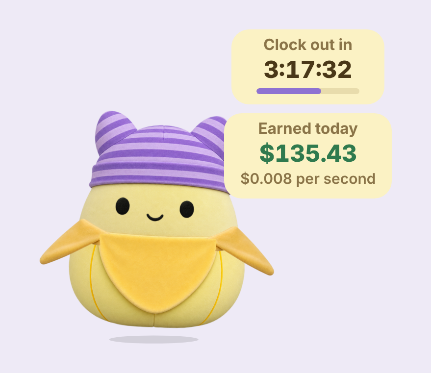
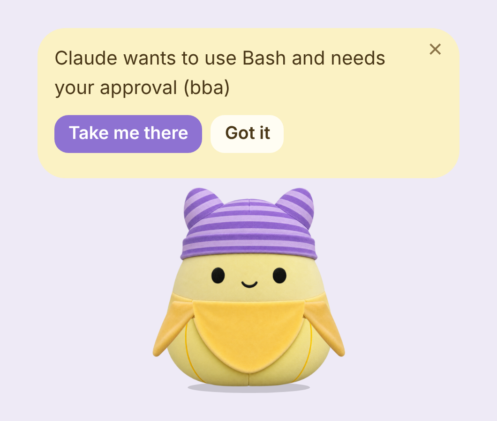
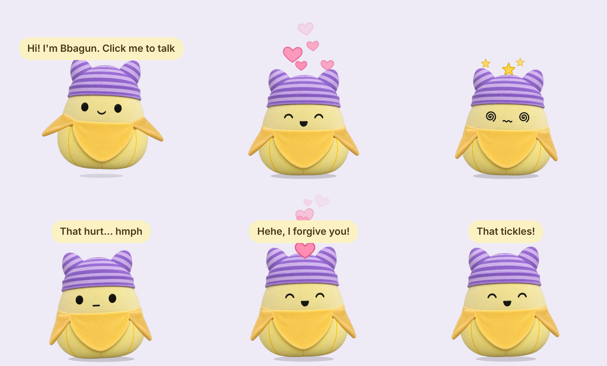

# Bba

> This repository only holds the installer and the user guide. **[Download the latest version](https://github.com/lilykwon/bba-releases/releases/latest)**
> [한국어](README.md)

**Your favorite plush, living on your Mac screen.** Turn one photo of your plush into your own desktop pet.
It wanders along the bottom of your screen, loves being petted, keeps you company while you focus, and chats with you through Claude or ChatGPT.

<p align="center"></p>

- **Make it from your plush:** a photo plus ChatGPT, about 15 minutes. Pick its parts and the app writes the prompts and assembles your pet
- **My characters:** keep several characters and switch between them. Each one has its own relationship with you
- **Chat:** click it to talk with **Claude** or **ChatGPT** (using your own account)
- **Focus timer:** say "I'll focus for 30 minutes" and it puts on glasses and counts down beside you
- **Reminders:** "Meeting at 3pm" and it reminds you on time
- **Office helper:** time until clock-out and what you've earned today, right next to your pet
- **AI task alerts:** it calls you when Claude Code or Codex needs your approval or finishes a task
- **Drag and drop:** drop a file or text on it to summarize, translate or proofread
- **Life together:** pet it for hearts, drop it from too high and it sulks. As you get closer it calls you by name and hums
- **Handy:** calm mode, quiet mode, four sizes, a shortcut to call it over, Korean and English

<p align="center"></p>

---

## Contents

1. [Install](#install)
2. [Connect an AI (optional)](#connect-an-ai-optional): [Claude](#connect-claude) or [ChatGPT](#connect-chatgpt)
3. [Make your own character](#make-your-own-character)
4. [How to use](#how-to-use)
   - [Basics](#basics)
   - [Chat](#chat)
   - [Focus timer](#focus-timer)
   - [Reminders](#reminders)
   - [Office helper](#office-helper)
   - [AI task alerts](#ai-task-alerts)
   - [Drag and drop](#drag-and-drop)
   - [Play with your pet](#play-with-your-pet)
   - [Life together](#life-together)
   - [Handy](#handy)
5. [Things you can say](#things-you-can-say)
6. [Right-click menu](#right-click-menu)
7. [FAQ](#faq)

---

## Install

1. Download **`Bba.dmg`** from [Releases](https://github.com/lilykwon/bba-releases/releases/latest). One file works on both Apple silicon and Intel Macs.
2. Open it and drag the **Bba** icon into your **Applications** folder.
3. Open **Bba** from Applications. Your pet drops in from the top of the screen.

> There's no Dock icon. **Right-click** the pet for the menu.

- You start with the default character, **Bbagun**. To use your own plush, see [Make your own character](#make-your-own-character).
- The app follows your Mac's language. To change it, right-click > **언어 / Language**.
- New versions download on their own. Install with right-click > **Install version X and restart**.

---

## Connect an AI (optional)

**Without an AI**, petting, the focus timer, reminders, the office helper, AI task alerts and tricks all work right away. To chat and to summarize or translate dropped text, connect either one below.

### Connect Claude

Use this if you have a Claude Pro or Max subscription. Chats count toward your subscription with no extra cost.

**1. Open Terminal.** Press `Cmd + Space`, type "Terminal" and open it.

**2. Install Claude Code.** Paste this line into Terminal and press Enter.

```bash
curl -fsSL https://claude.ai/install.sh | bash
```

> Install steps may change. If it doesn't work, see the [official Claude Code setup guide](https://docs.claude.com/en/docs/claude-code/setup).

**3. Log in.**

```bash
claude
```

Log in with your Claude account in the browser. Once Terminal shows a welcome screen you're done, and you can close it.

**4. Check in the pet.** Click your pet and press **Check again**. When you see "Claude connected!", start chatting.

### Connect ChatGPT

Use this if you have a ChatGPT Plus, Pro, Business, Edu or Enterprise subscription.

**1. Open Terminal.** Press `Cmd + Space`, type "Terminal" and open it.

**2. Install Codex.**

```bash
curl -fsSL https://chatgpt.com/codex/install.sh | sh
```

> With Homebrew, `brew install --cask codex` also works. See the [official Codex repository](https://github.com/openai/codex) for details.

**3. Log in.**

```bash
codex
```

Choose **Sign in with ChatGPT** and log in in the browser.

**4. Check in the pet.** Click your pet and press **Check again**. "ChatGPT connected!" means you're set.

> If you installed both, switch any time from right-click > **Connection**.

<details>
<summary>Use a Claude API key instead of a subscription</summary>

Get an API key at [console.anthropic.com](https://console.anthropic.com), then right-click > **Connection > Claude API key** and paste it. The key is stored encrypted on your Mac only, and you pay per use.
</details>

---

## Make your own character

### Make a pet from your plush

Right-click > **Character > Make a pet from my plush...** to open the wizard. All you need is a front photo of your plush and ChatGPT.

<p align="center"></p>

1. **Your plush:** name it, then pick its parts (ears, arms, legs, wings, tail) and how it moves (auto, hop, waddle, float)
2. **Make images:** the app writes a ChatGPT prompt for each image. Click **Copy prompt** on each card and send it to ChatGPT with your photo
3. **Add images:** drag the images ChatGPT made into the boxes. Backgrounds are removed and the face sheet is cut automatically. Drop several at once and they're sorted by file name
4. **Done:** the app places the eyes, nose and limbs. Preview faces and motions, then click **Finish** to swap your pet

### Adjust positions

Right-click > **Character > Adjust positions...** to fine-tune the face, eye size, where limbs attach and pivot, motion strength, glasses size and on-screen size with dots and sliders.

<p align="center"></p>

### Rename

Right-click > **Character > Rename...** and your pet asks for its new name. You can also just tell it:

- "Your name is Mochi"
- "I'll call you Bean"
- "Change your name to Puff"

### My characters

Every character you make or import is kept under right-click > **Character > My characters**.

- **Switch:** click a name to bring that character back. Each keeps its own name and positions
- **Separate relationships:** you might be best friends with Bbagun and just meeting your new character. Bring one back and it greets you the way it knows you
- **Shared:** focus records, reminders and your name are known to every character
- **Add a fresh Bbagun:** keeps your current character and brings in another default Bbagun
- **Remove from my characters:** clean up ones you don't use (you can't remove the one on screen)

> When you make or import a character, the previous one is also backed up. You can restore from right-click > **Character > Restore from backup**.

### Share characters

- **Export character...:** saves your pet as a single `.petchar` file you can send to a friend
- **Import character...:** opens a `.petchar` file. Double-clicking the file works too. Imported characters are added to My characters

---

## How to use

### Basics

| Action | Result |
|---|---|
| Click | Open or close the speech bubble |
| Drag | Pick up and move (drops when you let go) |
| Right-click | Open the menu |
| Esc | Close the speech bubble |
| ⌃⌥B (Control + Option + B) | Call your pet from anywhere |

Your pet wanders along the bottom of the screen, follows your cursor with its eyes, blinks, and falls asleep after 2 minutes alone.

### Chat

Click your pet and type. It answers in its own voice, moves its mouth while talking and makes a thinking face while it waits.

- **Right-click > Claude model:** Sonnet (default), Haiku (fast), Opus (smartest)
- **Right-click > New conversation:** forget the chat and start fresh
- Your pet only chats from an empty folder. It never reads your files or runs commands

### Focus timer

Just say it: "I'm going to focus for 30 minutes", "Let's do a pomodoro". Or pick 15 minutes to 1.5 hours, or a custom time, from right-click > **Focus timer**.

<p align="center"></p>

Your pet stops, puts on **glasses** and focuses. The time left floats beside it and blinks in the last 10 seconds. Click it to **pause** or **stop**. When time's up you get a sound and a notification, then **one more** or **5-minute break**.

It remembers today's focus time and your streak, and celebrates when you hit your daily goal (right-click > **Settings > Daily focus goal**, 1 to 4 hours).

### Reminders

Say it normally and it reminds you on time with a sound, a Mac notification and a bubble. **No AI needed** when your sentence has a time and a task.

- "Remind me in 20 minutes to do laundry"
- "Meeting at 3pm"
- "Remind me tomorrow at 9am to take vitamins"

When it goes off, pick **Thanks** or **Again in 10 min**. See and cancel upcoming ones from right-click > **Upcoming reminders**.

### Office helper

Two separate cards. Tell your pet to turn them on or off, no AI needed.

| Say | Your pet |
|---|---|
| "Start the countdown" | Shows the time until you clock out |
| "Show my earnings" | Shows what you've earned today |
| "Hide my salary" / "Show my salary" | Hides or shows the amount |
| "Turn off office" | Hides both cards |

Set your hours, lunch, annual salary and currency in right-click > **Office helper > Settings...**.

<p align="center"> </p>

- **Countdown:** "Work starts in" before work, "Clock out in" while working, "Lunch" during lunch, "Overtime" after
- **Live earnings:** adds up every second during work hours only (lunch excluded), with a coin popping over your pet's head. Hidden before work and on days off
- **Currency:** won, dollars, euros, yen and more. Defaults to your Mac's region
- **Hide the amount:** click the earnings card once before a meeting or screen share
- **Reactions:** says hi when work starts, warns 10 minutes before lunch, gets excited in the last 30 minutes and celebrates at clock-out

> Your salary stays on your Mac and is never sent to the AI.

### AI task alerts

Left Claude Code or Codex working while you do something else? Connect them and your pet calls you.

<p align="center"></p>

- **When approval is needed:** a bubble like "Claude wants to use Bash and needs your approval (project name)" plus a Mac notification. **Take me there** jumps to that Terminal, VS Code or the Claude app
- **When a task is done:** "Claude is done!" Skipped if you're already looking at that window
- **In quiet mode** you get the Mac notification only

**To connect**

1. Right-click > **AI task alerts > Connect Claude Code** (or Connect Codex)
2. A dialog shows which settings file changes and how. Click **Connect**
3. Sessions already open pick it up when restarted
4. **For Codex only:** open Codex, type `/hooks` and trust the two Bba hooks (Codex 0.124 or later)

The same menu lets you turn approval alerts and done alerts on or off separately.

> Works for Claude Code in Terminal, VS Code and the Claude app. Your pet only notifies; it never approves anything for you. The original settings file is backed up as `.bba-backup`, and turning it off removes only what Bba added. The ChatGPT app and claude.ai chats don't expose these events yet.

### Drag and drop

Drop a file or some text on your pet to **Summarize / Translate / Proofread / Ask about it**, then **Copy answer**. (Needs an AI connection.)

- Works with: text files (txt, md, csv, json, code), text dragged from the web or documents
- Not yet: PDF, Word, Hangul, images

### Play with your pet

<p align="center"></p>

| Do this | Your pet |
|---|---|
| Move the mouse back and forth over its head | Smiles and floats hearts |
| Lift it a little and let go | Lands softly and smiles |
| Drop it from mid height, or shake it | Gets dizzy, with stars over its head |
| Drop it from very high | Thud! Sulks and turns away. **Pet it to make up** |
| Click three times quickly | Giggles, it tickles |
| "Jump!", "Spin", "Dance", "Good night" | Little tricks |
| "Sing" | Hums for you once you're best friends |

### Life together

- **Time of day:** stretches in the morning, reminds you to eat at lunch, yawns and tells you to sleep late at night
- **Welcome back:** greets you when you unlock your Mac or wake it from sleep
- **Breaks:** after an hour straight, suggests a stretch or some water (turn off in right-click > **Settings**)
- **Relationship:** petting, chatting, focusing together and opening the app each day bring you closer: **Just met → Acquaintances → Friends → Best friends → Family**. It never drops from time away. Dropping it from high up costs a little. Each character has its own
  - **As friends** it asks your name and uses it. Say "call me Lilly" any time to change it
  - **As best friends** it hums when it's happy
  - **As family** it greets you even more warmly
- **Anniversaries:** 7 days, 30 days, 100 days, a year. It notices streaks too
- **Mood of the day:** excited, calm, bored or sleepy depending on how much you played. A fresh start every day

### Handy

- **Call it over:** press **⌃⌥B** (Control + Option + B) and your pet comes to your cursor with the bubble open
- **Calm mode:** right-click > **Movement > Calm**, or say "calm down". It stays near where you last put it and rests more. "Go wild" makes it lively, "act normal" goes back
- **Quiet mode:** "Be quiet" or right-click > **Quiet mode**. No chatter, just naps. Reminders and AI task alerts still arrive as Mac notifications. "You can talk now" ends it
- **Size:** right-click > **Size**, or say "shrink", "grow", "normal size"
- **Language:** right-click > **언어 / Language**: follow system language, 한국어, English. Menus, bubbles, settings and the wizard all switch, and it understands English commands
- **Open at login:** your pet appears every time you start your Mac

---

## Things you can say

These work without an AI. Korean works too.

| Say | Your pet |
|---|---|
| "Meeting at 3pm", "remind me in 20 minutes to do laundry" | Sets a reminder |
| "Start the countdown", "show my earnings" | Turns on office cards |
| "Hide my salary", "turn off office" | Hides the amount, turns off cards |
| "Be quiet" / "you can talk now" | Quiet mode on, off |
| "Calm down" / "go wild" / "act normal" | Calm, lively, normal |
| "Shrink" / "grow" / "normal size" | Changes size |
| "Jump", "spin", "dance", "good night" | Tricks |
| "Sing" | Hums (best friends and up) |
| "Call me Lilly" | Remembers your name |
| "Your name is Mochi" | Renames your pet |

---

## Right-click menu

| Menu | What's inside |
|---|---|
| (top) | Your relationship |
| Focus timer | Today's focus, 15 min to 1.5 hours, custom |
| Office helper | Countdown, live earnings, hide amount, settings |
| Upcoming reminders | Only when you have some. Click to cancel |
| Settings | Break reminders, daily focus goal |
| New conversation | Start the chat fresh |
| Connection | Claude, ChatGPT, Claude API key |
| Claude model | Sonnet, Haiku, Opus |
| Character | My characters, rename, make from my plush, adjust positions, export, import, restore from backup, open folder, back to the default |
| AI task alerts | Connect Claude Code, connect Codex, approval alerts, done alerts |
| Quiet mode | Reminders only |
| Movement | Lively, normal, calm |
| Size | Extra small, small, normal, large |
| Call over, put to sleep, wake up | |
| Open at login | |
| Check for updates | |
| 언어 / Language | Follow system, 한국어, English |
| Quit | |

---

## FAQ

<details>
<summary><b>Can I use it without an AI?</b></summary>

Yes. Reactions, the focus timer, reminders, the office helper, AI task alerts, greetings and break reminders all work without one. Chatting and summarizing or translating dropped text need an AI connection.
</details>

<details>
<summary><b>Does switching characters reset the relationship?</b></summary>

No. Each character keeps its own relationship and anniversaries. Switch away and back and it's all still there.
</details>

<details>
<summary><b>It says I need to log in</b></summary>

Run `claude` (or `codex` for ChatGPT) in Terminal, log in, then talk to your pet again.
</details>

<details>
<summary><b>I turned on AI task alerts but nothing arrives</b></summary>

Restart any Claude Code or Codex session that was already open. For Codex, check that the Bba hooks are trusted in `/hooks`. Alerts only arrive while Bba is running.
</details>

<details>
<summary><b>Where do my chats go?</b></summary>

The app has no server. Chats go straight to the Claude (Anthropic) or ChatGPT (OpenAI) account you logged into. An API key, if you use one, is stored encrypted on your Mac only.
</details>

<details>
<summary><b>Can the pet touch my files or run commands?</b></summary>

No. It chats from its own empty folder. Claude runs with file and command tools turned off, and ChatGPT runs in read-only mode. AI task alerts only notify; they never run or approve anything.
</details>

---

## License

Bba © 2026 WOX Studio. The default character "Bbagun" images may not be used or redistributed outside the app.
