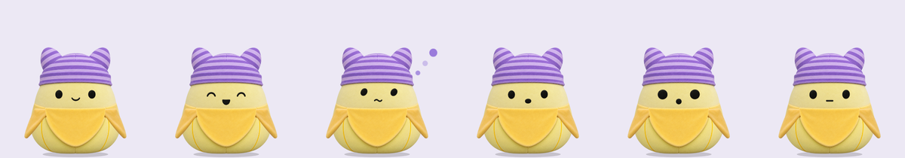
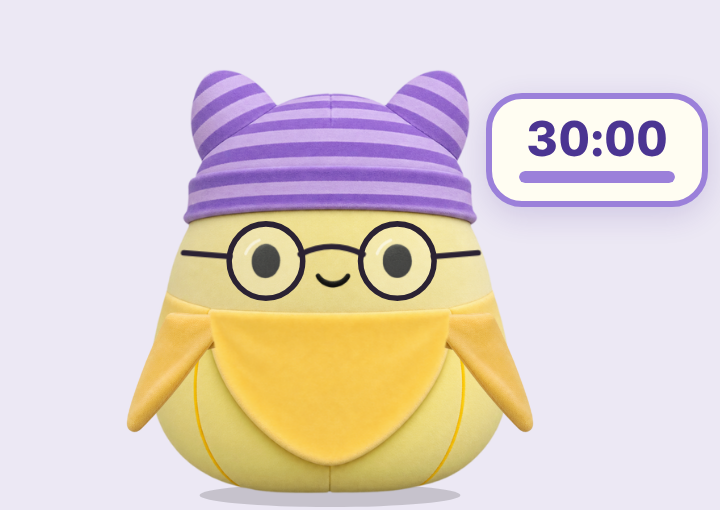
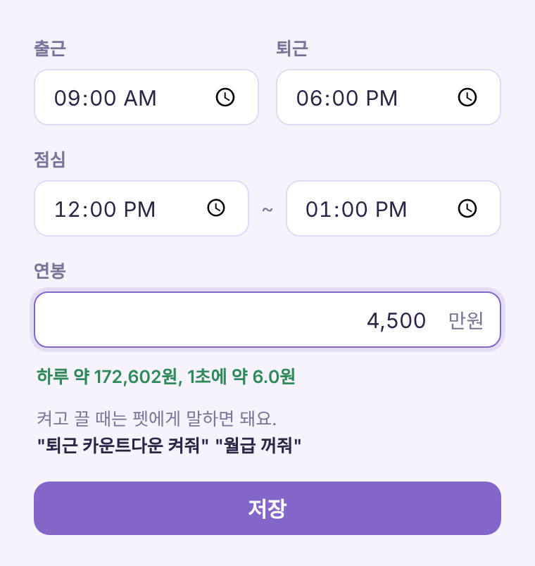

# Bba

> 설치 파일과 사용 안내만 있는 저장소예요. **[최신 버전 내려받기](https://github.com/lilykwon/bba-releases/releases/latest)**

**내 애착인형이 맥 화면 속으로.** 인형 사진 한 장으로 나만의 데스크탑 펫을 만들어요.
화면 아래를 돌아다니고, 쓰다듬으면 좋아하고, 같이 집중하고, 누르면 Claude나 ChatGPT와 대화해요.

<p align="center"></p>

- **내 인형으로 만들기:** 귀, 팔, 다리, 날개, 꼬리 중 인형에 있는 부위를 고르면, 앱이 ChatGPT용 프롬프트를 만들어 주고 자동으로 조립해요
- 콩콩 뛰거나, 다리로 아장아장 걷거나, 둥둥 떠다녀요
- 커서를 눈으로 따라보고, 눈을 깜빡이고, 2분 동안 안 건드리면 잠들어요
- 누르면 말풍선이 열리고 **Claude** 또는 **ChatGPT**와 대화해요 (각자 쓰는 계정으로 로그인)
- 드래그로 들어서 옮길 수 있어요. 놓으면 톡 떨어져요
- **집중 타이머:** "30분 집중할게"라고 말하면 안경을 쓰고 옆에서 카운트다운해 줘요
- **사무실 도우미:** "퇴근 카운트다운 켜줘", "월급 켜줘"라고 말하면 퇴근까지 남은 시간과 오늘 번 돈을 펫 옆에 보여줘요
- **쓰담쓰담하면 하트**, 높이서 떨구면 어지러워하거나 삐쳐요
- **파일이나 글을 끌어다 놓으면** 요약, 번역, 맞춤법 검사를 해줘요
- **"3시에 미팅 있어"** 라고 하면 그 시간에 알려줘요
- 아침, 점심, 새벽에 말을 걸고, 1시간 넘게 앉아 있으면 쉬자고 해요

<p align="center"></p>

---

## 목차

1. [설치하기](#설치하기)
2. [내 캐릭터로 바꾸기](#내-캐릭터로-바꾸기) (자세한 따라하기는 [GUIDE.md](GUIDE.md))
3. [Claude 연결하기](#claude-연결하기) 또는 [ChatGPT 연결하기](#chatgpt-연결하기) (선택)
4. [사용법](#사용법)
   - [집중 타이머](#집중-타이머)
   - [사무실 도우미](#사무실-도우미)
   - [펫과 놀기](#펫과-놀기)
   - [끌어다 놓기](#끌어다-놓기)
   - [일정 알림](#일정-알림)
   - [같이 지내기](#같이-지내기)
5. [자주 묻는 질문](#자주-묻는-질문)

---

## 설치하기

1. [Releases](https://github.com/lilykwon/bba-releases/releases/latest)에서 **`Bba.dmg`**를 내려받아요. 애플 실리콘과 인텔 맥 모두 이 파일 하나로 돼요.
2. 받은 파일을 열고, **Bba** 아이콘을 **응용 프로그램(Applications)** 폴더로 끌어다 놓아요.
3. 응용 프로그램 폴더에서 **Bba**를 실행하면 화면 위에서 펫이 톡 떨어져요.

> Dock에는 아이콘이 안 생겨요. 펫을 **우클릭**하면 메뉴가 나와요.

처음엔 기본 캐릭터 **빠군**이 나와요. [내 인형으로 바꾸려면 여기](#내-캐릭터로-바꾸기)를 보세요.

**AI 연결은 선택이에요.** 연결하지 않아도 쓰담쓰담, 집중 타이머, 알림("3시에 미팅 알려줘")은 바로 돼요. 대화까지 하고 싶다면 아래 [Claude](#claude-연결하기)나 [ChatGPT](#chatgpt-연결하기) 중 편한 쪽 하나만 연결하면 돼요.

---

## 내 캐릭터로 바꾸기

**우클릭 > 캐릭터 > 내 인형으로 새로 만들기...** 를 누르면 만들기 마법사가 열려요. 인형 정면 사진과 ChatGPT만 있으면 돼요.

<p align="center"></p>

1. **인형 소개:** 이름을 짓고, 인형에 있는 부위(귀, 팔, 다리, 날개, 꼬리)와 움직이는 방식(콩콩, 아장아장, 둥둥)을 골라요
2. **이미지 만들기:** 고른 부위에 맞춰 앱이 ChatGPT 프롬프트를 만들어 줘요. 카드마다 **프롬프트 복사**를 눌러 인형 사진과 함께 ChatGPT에 보내요
3. **이미지 넣기:** ChatGPT가 만든 이미지를 칸에 끌어다 놓아요. 배경은 자동으로 지우고, 표정 시트도 자동으로 잘라요
4. **완성:** 앱이 눈, 코, 팔다리 위치를 자동으로 잡아요. 미리 보고 **완성하기**를 누르면 화면의 펫이 바뀌어요

화면 하나하나 따라 하는 자세한 설명은 **[GUIDE.md](GUIDE.md)** 에 있어요.

> 예전 캐릭터는 자동으로 백업돼요. **우클릭 > 캐릭터 > 백업에서 되돌리기**로 언제든 돌아갈 수 있어요.

### 캐릭터 나누기

- **캐릭터 내보내기...:** 지금 펫을 `.petchar` 파일 하나로 저장해요. 친구에게 보내면 그대로 가져올 수 있어요
- **캐릭터 가져오기...:** 받은 `.petchar` 파일을 열어요 (앱으로 만든 버전은 파일을 더블클릭해도 돼요)
- **위치 맞추기...:** 눈, 팔다리 위치와 크기, 움직임 세기를 점과 슬라이더로 다듬어요

<details>
<summary>마법사 없이 파일을 직접 넣고 싶다면 (고급)</summary>

**우클릭 > 캐릭터 > 캐릭터 폴더 열기**에서 아래 파일을 넣고 **위치 맞추기**에서 **이미지 다시 읽기**를 누르면 돼요. 프롬프트는 [PROMPTS.md](PROMPTS.md)에 있어요.

| 파일 | 내용 |
|---|---|
| `body.png` (필수) | 정면 몸통. 눈, 입은 비우고, 따로 움직일 부위는 뺀 그림. 코, 볼터치, 무늬는 남겨요 |
| `faces.png` (필수) | 눈과 입만 있는 표정 9개, 3x3 (순서: 기본, 눈 감음, 웃음 / 말하기, 생각, 졸림 / 깜짝, 시무룩, 자유) |
| `ear.png`, `arm.png`, `leg.png`, `wing.png` | **왼쪽** 한 쪽만. 오른쪽은 좌우를 뒤집어서 써요 |
| `tail.png` | 꼬리 하나 |
| `front.png` | 부위 위를 덮는 앞 레이어. `body.png`와 같은 크기 |

배경은 투명하지 않아도 돼요. 한 가지 색이면 자동으로 지워요.
</details>

---

## Claude 연결하기

Claude Pro 또는 Max 구독이 있다면 이 방법을 쓰세요. 추가 비용 없이 구독 사용량 안에서 대화해요.

**1. 터미널 열기**
`Cmd + Space`를 누르고 "터미널"을 입력해서 열어요.

**2. Claude Code 설치**
아래 한 줄을 복사해서 터미널에 붙여넣고 Enter를 눌러요.

```bash
curl -fsSL https://claude.ai/install.sh | bash
```

> 설치 방법은 바뀔 수 있어요. 안 되면 [Claude Code 공식 설치 안내](https://docs.claude.com/en/docs/claude-code/setup)를 확인해 주세요.

**3. 로그인**
설치가 끝나면 터미널에 아래를 입력해요.

```bash
claude
```

브라우저가 열리면 Claude 계정으로 로그인하고, 터미널에 "Welcome" 같은 화면이 보이면 끝이에요. 터미널은 닫아도 돼요.

**4. 펫에서 확인**
펫을 누르고 **다시 확인**을 눌러요. "Claude 연결 완료!"가 나오면 바로 대화할 수 있어요.

---

## ChatGPT 연결하기

ChatGPT Plus, Pro, Business, Edu, Enterprise 구독이 있다면 이 방법을 쓰세요.

**1. 터미널 열기**
`Cmd + Space`를 누르고 "터미널"을 입력해서 열어요.

**2. Codex 설치**

```bash
curl -fsSL https://chatgpt.com/codex/install.sh | sh
```

> Homebrew를 쓴다면 `brew install --cask codex`도 돼요. 자세한 내용은 [Codex 공식 저장소](https://github.com/openai/codex)를 확인해 주세요.

**3. 로그인**

```bash
codex
```

**Sign in with ChatGPT**를 고르고 브라우저에서 로그인해요.

**4. 펫에서 확인**
펫을 누르고 **다시 확인**을 눌러요. "ChatGPT 연결 완료!"가 나오면 끝이에요.

> 둘 다 설치했다면 펫 **우클릭 > 연결**에서 Claude와 ChatGPT를 언제든 바꿀 수 있어요.

<details>
<summary>구독 없이 Claude API 키로 쓰고 싶다면</summary>

[console.anthropic.com](https://console.anthropic.com)에서 API 키를 발급받고, 펫 **우클릭 > 연결 > Claude API 키**를 고른 뒤 키를 붙여넣어요. 키는 내 맥에만 암호화되어 저장되고, 쓴 만큼 과금돼요.
</details>

---

## 사용법

| 동작 | 결과 |
|---|---|
| 클릭 | 말풍선 열기 / 닫기 |
| 드래그 | 들어서 옮기기 (놓으면 바닥으로 톡) |
| 우클릭 | 메뉴 열기 |
| Esc | 말풍선 닫기 |

**우클릭 메뉴**

- **집중 타이머**: 15분 ~ 1시간 30분, 또는 직접 입력
- **사무실 도우미**: 퇴근 카운트다운, 실시간 월급, 금액 숨기기, 설정
- **대화 새로 시작**: 앞의 대화를 잊고 처음부터
- **연결**: Claude / ChatGPT / API 키 중 고르기
- **Claude 모델**: Sonnet (기본), Haiku (빠름), Opus (가장 똑똑함)
- **캐릭터**: 내 인형으로 새로 만들기, 위치 맞추기, 내보내기, 가져오기, 백업에서 되돌리기
- **재우기 / 깨우기**
- **로그인 시 자동 실행**: 맥을 켤 때마다 펫이 나타나요
- **종료**

### 집중 타이머

펫에게 평소처럼 말하면 돼요. Claude(또는 ChatGPT)가 알아듣고 자기 말로 대답한 뒤 타이머를 켜줘요. **우클릭 > 집중 타이머**에서 시간을 바로 골라도 돼요.

- "나 지금 30분 동안 집중할거야"
- "40분 동안 보고서 쓸게"
- "뽀모도로 한 번 하자"
- 집중 중에 "몇 분 남았어?", "그만할래"

"어제 30분 공부했어"처럼 그냥 하는 이야기에는 타이머를 켜지 않아요.

<p align="center"></p>

시작하면 펫이 그 자리에 멈춰서 **안경을 쓰고** 아래를 보며 집중해요. 옆에 남은 시간이 떠 있고, 마지막 10초는 깜빡여요.
집중하는 동안 펫을 누르면 **일시정지 / 그만하기**를 고를 수 있어요. 대화도 평소처럼 할 수 있어요.
끝나면 소리와 알림으로 알려주고, **한 번 더** 또는 **5분 쉬기**를 고를 수 있어요.

> 안경은 캐릭터 눈 위치에 맞춰 자동으로 그려져요. 크기가 안 맞으면 위치 맞추기 창의 **안경 (집중 모드)**에서 조절하세요.

### 사무실 도우미

두 가지가 따로 있어요. 펫에게 말하면 켜지고 꺼져요 (AI 연결 없이도 돼요).

| 이렇게 말하면 | 펫은 |
|---|---|
| "퇴근 카운트다운 켜줘" | 퇴근까지 남은 시간 카드를 띄워요 |
| "월급 켜줘" | 오늘 번 돈 카드를 띄워요 |
| "월급 숨겨줘" / "월급 보여줘" | 금액을 가리거나 다시 보여줘요 |
| "퇴근 카운트다운 꺼줘", "월급 꺼줘", "사무실 꺼줘" | 카드를 내려요 |

출퇴근 시간, 점심시간, 연봉은 **우클릭 > 사무실 도우미 > 설정...** 에서 넣어요. 연봉 없이 "월급 켜줘"라고 하면 설정 창이 먼저 열려요.

<p align="center"></p>

- **퇴근 카운트다운:** 출근 전엔 "출근까지", 근무 중엔 "퇴근까지", 점심엔 "점심시간 ~13:00", 퇴근 후엔 "야근 +23분"
- **실시간 월급:** 근무 시간에만 1초마다 쌓여요 (점심시간 제외). 만 원마다 펫 머리 위로 동전이 튀어요. 출근 전과 주말엔 카드가 숨어요
- **금액 가리기:** 회의나 화면 공유할 때 월급 카드를 한 번 누르면 가려져요
- **펫 반응:** 출근하면 인사, 점심 10분 전 알림, 퇴근 30분 전부터 들썩들썩, 퇴근 시간엔 하트를 뿜으며 "퇴근이다!!"
- 메뉴(**우클릭 > 사무실 도우미**)에서도 각각 켜고 끌 수 있어요

> 연봉은 이 맥에만 저장되고 AI에게 보내지 않아요. 연봉 ÷ 1년 근무일(주 5일 × 52주) ÷ 하루 근무 시간으로 계산해요.

### 펫과 놀기

<p align="center"></p>

| 이렇게 하면 | 펫은 |
|---|---|
| 머리 위에서 마우스를 좌우로 왔다 갔다 (쓰담쓰담) | 웃으면서 하트가 뾰로롱 |
| 조금 들었다 놓기 | 톡 착지하고 웃어요 |
| 중간 높이에서 떨구기, 또는 들고 마구 흔들기 | 눈이 빙글빙글, 머리 위로 별이 돌아요 |
| 아주 높이서 떨구기 | 쿵! 삐쳐서 고개를 돌려요. 눌러도 "흥!" **쓰다듬어 주면 풀려요** |
| 빠르게 세 번 콕콕 | 간지러워하며 몸을 비틀어요 |

### 끌어다 놓기

파일이나 글을 펫 위로 끌어다 놓으면 **요약 / 번역 / 맞춤법 / 직접 물어보기** 중에 고를 수 있어요. 답이 나오면 **답 복사** 버튼이 생겨요.

- 읽을 수 있는 것: 글로 된 파일(txt, md, csv, json, 코드 등), 웹이나 문서에서 드래그한 글
- 아직 못 읽는 것: PDF, Word, 한글, 이미지

### 일정 알림

평소처럼 말하면 돼요. 펫이 알아듣고 그 시간에 소리와 알림으로 알려줘요. AI를 연결하지 않아도 시간과 할 일이 들어간 말은 알아들어요.

- "20분 뒤에 빨래 꺼내라고 알려줘"
- "오늘 오후 3시에 미팅 있어"
- "내일 아침 9시에 약 먹으라고 해줘"
- "나 알림 뭐 있었지?"

예정된 알림은 **우클릭 > 예정된 알림**에서 보고, 눌러서 취소할 수 있어요.

### 같이 지내기

- **시간대 인사:** 아침엔 기지개를 켜며 인사, 점심엔 밥 챙겨 먹으라고, 새벽까지 깨어 있으면 하품하며 자라고 해요
- **쉬는 시간:** 1시간 넘게 계속 컴퓨터를 쓰면 기지개나 물 마시기를 권해요 (우클릭 > 설정에서 끌 수 있어요)
- **집중 기록:** 오늘 집중한 시간과 연속 일수를 기억해요. 집중이 끝날 때 알려주고, 우클릭 메뉴 맨 위에도 보여요. 하루 목표는 우클릭 > 설정에서 정해요
- **친밀도:** 쓰담쓰담, 대화, 같이 집중한 시간이 쌓이면 **처음 만난 사이 → 친구 → 단짝 → 베프**로 친해져요. 친해질수록 반기는 모습과 말투가 달라져요. 높이서 떨구면 조금 멀어져요

---

## 자주 묻는 질문

<details>
<summary><b>AI 연결 없이도 쓸 수 있나요?</b></summary>

네. 쓰담쓰담 같은 반응, 집중 타이머, 알림, 시간대 인사, 쉬는 시간 알림은 AI 없이 동작해요. 대화, 끌어다 놓은 글 요약이나 번역만 AI 연결이 필요해요.
</details>

<details>
<summary><b>내 인형 이미지가 원본이랑 달라요</b></summary>

ChatGPT에서 같은 프롬프트로 몇 번 다시 만들어서 가장 비슷한 걸 고르세요. 몸통 한 장만 잘 나오면 나머지는 맞춰져요. 흰 인형이라면 배경을 연두색으로 받아야 깔끔하게 지워져요 (프롬프트에 이미 들어 있어요).
</details>

<details>
<summary><b>펫을 눌렀는데 "로그인이 필요해요"라고 나와요</b></summary>

터미널에서 `claude` (ChatGPT라면 `codex`)를 실행해서 로그인한 뒤, 펫에게 다시 말을 걸어주세요.
</details>

<details>
<summary><b>설치했는데 "다시 확인"을 눌러도 연결이 안 돼요</b></summary>

펫을 완전히 종료(우클릭 > 종료)하고 다시 실행해 보세요. 그래도 안 되면 터미널에서 `which claude` 또는 `which codex`를 입력했을 때 경로가 나오는지 확인해 주세요.
</details>

<details>
<summary><b>답이 조금 늦게 와요</b></summary>

Claude Code나 Codex를 거쳐서 대화하기 때문에 첫 답이 몇 초 걸릴 수 있어요. 그동안 펫이 생각하는 표정을 지어요. 우클릭 > Claude 모델에서 **Haiku**를 고르면 더 빨라요.
</details>

<details>
<summary><b>대화 내용은 어디로 가나요?</b></summary>

이 앱은 따로 서버가 없어요. 대화는 내가 로그인한 Claude(Anthropic) 또는 ChatGPT(OpenAI) 계정으로 바로 전송돼요. API 키를 쓰는 경우 키는 내 맥에만 암호화되어 저장돼요.
</details>

<details>
<summary><b>펫이 파일을 건드리거나 명령을 실행하나요?</b></summary>

아니요. 펫 전용 빈 폴더에서 대화만 해요. Claude 연결은 파일 읽기, 명령 실행 같은 도구를 전부 끈 채로, ChatGPT 연결은 읽기 전용 모드로 실행돼요.
</details>

<details>
<summary><b>펫이 너무 크거나 작아요</b></summary>

우클릭 > 캐릭터 > 위치 맞추기에서 맨 아래 **화면에 보이는 크기**를 조절하세요.
</details>

---

## 라이선스

Bba © 2026 WOX Studio. 기본 캐릭터 "빠군" 이미지는 앱 안에서 펫으로 쓰는 것 외에 다른 용도로 쓰거나 재배포할 수 없어요.
